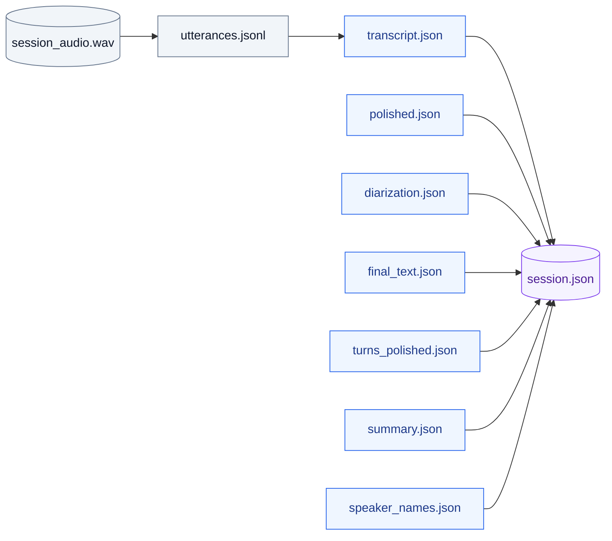

# Meeting_main — 会议智能转写与工作台（工程手册）

> 想看全局定位与评测对比，去仓库根目录的 [README.md](../README.md)。
> 这一份只讲：**怎么跑、参数什么意思、落盘数据契约是什么、HTTP 接口怎么调**。

---

## 环境

| 项 | 值 |
|---|---|
| Python | 3.12（conda env `funasr`） |
| 输入 | 16 kHz 单声道 WAV；多声道只取 **ch0**，严禁 `-ac 1` 均值下混 |
| 依赖 | 沿用 `../diarization_cl-main/requirements.txt` + `pyannote.audio` |
| 系统依赖 | `ffmpeg`（非 16kHz/单声道时自动转码） |
| 模型 | FSMN-VAD / CAM++ / Paraformer-Streaming / SEACO / Pyannote-3.0 |

```powershell
$env:PYTHONIOENCODING="utf-8"        # 必设；否则 Windows 控制台按 GBK 解析中文会乱码
$env:DEEPSEEK_API_KEY="sk-..."       # 可选；不配则自动跳过 LLM 润色与纪要，声学主链照常运行
```

---

## 运行

### 1. CLI 命令行（`run_offline.py`）

```bash
# 录音高精直通模式（处理已有录音文件最快 RTF 0.047、最准 CER 25.35%）
python run_offline.py --wav meeting.wav --direct-offline

# 流式全速仿真模式（经过流式 VAD + 流式 ASR + 漏段补偿 + 离线二遍）
python run_offline.py --wav meeting.wav --fast

# 1:1 实时节奏送流模式（按音频墙钟送流，用来测量首字/定稿延迟）
python run_offline.py --wav meeting.wav
```

### 2. HTTP 工作台服务（`:8736`）

```bash
python stream_service.py          # http://127.0.0.1:8736（仅监听本机）
```

| 路由 | 作用 |
|---|---|
| `GET /` | 极简高管工作台页面（自动注入 `meeting_bridge.js`） |
| `GET /api/health` | `{ok, busy, resetting}` |
| `GET /api/sessions` | 历史会话列表（含时长、说话人数、纪要标题） |
| `GET /api/sessions/<id>` | 单场完整 `session.json` |
| `DELETE /api/sessions/<id>` | 删除指定历史会话 |
| `GET /api/sessions/<id>/audio` | 会话音频流（支持 **HTTP 206 Range**，前端点击任意句子跳转播放） |
| `POST /api/sessions/<id>/summary` | 为历史会话一键生成或重新生成会后小秘书纪要 (`summary.json`) |
| `POST /api/sessions/<id>/speakers` | 持久化保存发言人自定义姓名 (`speaker_names.json`) |
| `POST /api/stream_meeting?name=&fast=&direct=&silence=` | 上传音频文件，返回 NDJSON 事件流（前端导入默认 `direct=1`） |
| `POST /api/live/start` | 开启浏览器实时麦克风录音，初始化磁盘 `session_audio.wav` |
| `POST /api/live/chunk` | 每 0.7 秒接收 16kHz PCM 分块写盘，返回实时 `asr_partial` / `asr_final` / `llm_confirmed` |
| `POST /api/live/finish` | 结束麦克风录音，执行漏段扫描恢复、声纹聚类、字级对齐、并发精修与纪要生成 |
| `POST /api/stream_meeting/cancel` | 提前结束当前流并进入会后处理阶段 |
| `POST /api/stream_meeting/reset` | 丢弃当前正在运行的任务 |

### 3. CLI 参数表

| 参数 | 默认 | 说明 |
|---|---|---|
| `--wav` | 必填 | 输入音频路径（多声道自动取 `ch0`） |
| `--direct-offline` | 关 | **高精直通开关**：跳过流式 ASR，直接用 Pyannote 17ms 区间 + 离线 SEACO 转写 |
| `--session-dir` | 自动 | 指定输出目录 |
| `--session-root` | `output/sessions` | 自动建 `s_YYYYMMDD_HHMMSS` |
| `--chunk-ms` | `600` | 流式送流粒度（ms） |
| `--silence-ms` | `1000` | 流式 VAD 句尾静音阈值（ms） |
| `--max-seconds` | `0` | 只处理前 N 秒，调试用 |
| `--fast` | 关 | 全速推流，不按墙钟节流 |
| `--no-llm` | 关 | 跳过流式单句 DeepSeek 纠错 |
| `--no-diar` | 关 | 跳过会后说话人声纹分离回填 |
| `--no-final-asr` | 关 | 跳过离线 SEACO 二遍重转写 |
| `--no-final-polish` | 关 | 跳过会后 4 线程双向语境精修 |
| `--no-summary` | 关 | 跳过会后小秘书纪要生成 |
| `--strict-polish` | 关 | 只允许同音字原位替换，测 CER 用 |

---

## 数据契约

### 1. 会话目录与幂等合并流程



| 文件 | 何时生成 | 说明 |
|---|---|---|
| `session_audio.wav` | 边收边写 | 16 kHz 单声道，**采样点时钟的唯一真相** |
| `events.ndjson` | 每个流式事件 | 追加写（`asr_partial` / `asr_final` / `llm_confirmed`） |
| `utterances.jsonl` | 每句 `asr_final` | 追加写 |
| `transcript.json` | 初遍结束 | T+0 初遍转写快照（含流式漏段补偿句） |
| `polished.json` | 流式单句润色 | `--no-llm` 或 `--direct-offline` 时不存在 |
| `diarization.json` | 声纹回填完成 | 含句级 `spk` 与句内换人 `sub_turns` |
| `final_text.json` | 离线二遍完成 | SEACO 字级毫秒时间戳对齐后的文本 |
| `turns_polished.json` | 会后精修完成 | 4 线程前后双向语境精修覆盖 |
| `summary.json` | 会后纪要完成 | `{title, overview, topics, decisions, action_items, speaker_roles}` |
| `speaker_names.json` | 前端点击改名 | `{"speaker_0": "李经理", "speaker_2": "张总"}` |
| `session.json` | 每次合并 | 幂等合成，所有 `*.json` 均走「临时文件 + `os.replace`」原子替换 |

### 2. 时间戳铁律与文本优先级

- **时间戳铁律**：`start_ms` / `end_ms` 只由累计采样点数算出（`samples * 1000 // 16000`），严禁使用 `time.time()`，确保字幕与音频文件零漂移。
- **`turns[].text` 四级回退优先级**：`turns_polished` > `final_text` > `polished_text` > `raw_text`。

---

## 测试

```bash
python -m pytest -q                            # 223 passed, 4 deselected（秒级完成）
python -m pytest -m slow -k equivalence -v     # 真实模型事件级等价夹具（约 30 s）
```

---

## 排障

| 症状 | 原因与解决 |
|---|---|
| 中文输出乱码 | 没设 `$env:PYTHONIOENCODING="utf-8"` |
| 历史记录点击「生成纪要」报 `Error: not found` | 旧版 `stream_service.py` 进程仍占着 8736 端口，重启服务即可 |
| 进程卡死在启动 | Windows Python 3.12 的 WMI 查询死锁，需保留 `web_server.py` 顶部 `platform._wmi_query` 补丁 |
| 多声道结果变差 | 用了 `-ac 1` 均值下混；必须只取 `ch0` |
