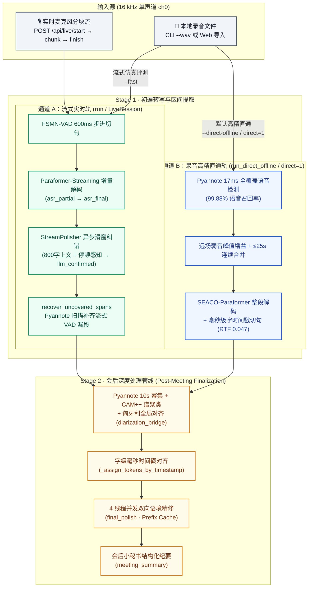
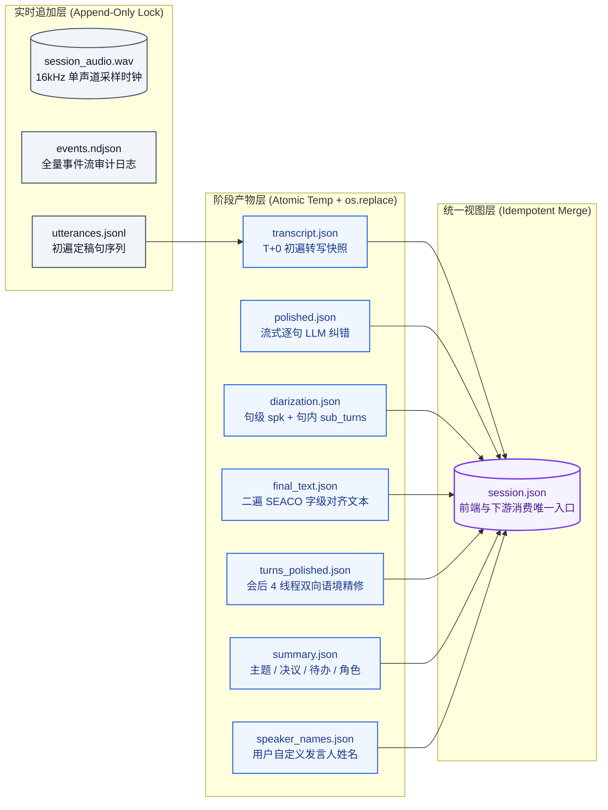

# Meeting_main — 会议智能转写与工作台（工程手册）

> 想看项目全局定位、全栈架构图与数据集评测对比，请查阅仓库根目录 [README.md](../README.md)。
> 本手册面向工程开发与运维排障，重点阐述：**双执行通道原理、原子落盘数据契约、HTTP 接口协议、CLI 参数与测试验证**。

---

## 一、 双通道编排流水线

`Meeting_main` 提供两条互补的音频处理通道，最终汇聚到同一套会后说话人分离、字级对齐、并发精修与纪要提炼管线：



---

## 二、 原子落盘与数据合并契约

每个会话在 `output/sessions/<session_id>/` 下拥有独立目录。系统采用**「分阶段独立落盘 + `SessionStore.rebuild_session_json()` 幂等合成」**机制：任何后处理阶段（如单独重跑精修、重新生成纪要或修改说话人姓名）只需更新对应组件文件并触发合成，绝不破坏原始转写时间轴。

### 1. 会话目录数据流图



### 2. 文件清单与职责说明

| 文件名 | 生成时机 | 写入策略 | 核心内容说明 |
|---|---|---|---|
| `session_audio.wav` | 录音/导入开始时 | 流式边收边写 | 16 kHz 单声道 PCM，**所有时间戳的唯一物理时钟** |
| `events.ndjson` | 每个流式事件触发 | 线程锁逐行追加 | 完整记录 `asr_partial` / `asr_final` / `llm_confirmed` |
| `utterances.jsonl` | 每句 `asr_final` | 线程锁逐行追加 | 初遍锁定的 `[start_ms, end_ms, raw_text]` |
| `transcript.json` | 初遍转写结束 | 原子替换 (`os.replace`) | T+0 初遍快照（含流式漏段补偿后的句子） |
| `polished.json` | 流式单句润色完成 | 原子替换 (`os.replace`) | `utt_id -> {polished_text, corrected, bypassed, error}` |
| `diarization.json` | 声纹聚类回填完成 | 原子替换 (`os.replace`) | `utt_id -> {spk, spk_label, overlap_spk, sub_turns}` |
| `final_text.json` | 离线二遍对齐完成 | 原子替换 (`os.replace`) | `utt_id -> {final_text, sub_final_texts}` |
| `turns_polished.json` | 会后按段精修完成 | 原子替换 (`os.replace`) | `turn_id -> polished_turn_text`（双向语境精修） |
| `summary.json` | 会后小秘书生成 | 原子替换 (`os.replace`) | `{title, overview, topics, decisions, action_items, speaker_roles}` |
| `speaker_names.json` | 用户在前端点击改名 | 原子替换 (`os.replace`) | `{"speaker_0": "李经理", "speaker_2": "张总"}` |
| **`session.json`** | **任意阶段更新后** | **幂等重算 + 原子替换** | 合成 `utterances`、`turns`、`summary`、`speaker_names` 的最终交付件 |

### 3. 文本优先级与时间戳铁律

- **时间戳铁律**：所有 `start_ms` / `end_ms` 仅由采样点数推导（`samples * 1000 // 16000`），严禁使用系统墙钟 `time.time()`，确保无论 CPU 快慢，字幕与 `session_audio.wav` 毫秒级严丝合缝。
- **四级文本回退优先级**：在合成 `session.json` 的 `turns[].text` 时，系统严格按以下优先级选取最优文本：
  1. `turns_polished.json`（会后按说话人段落的双向语境精修文本）
  2. `final_text.json`（离线 SEACO 字级毫秒时间戳对齐文本）
  3. `polished.json`（流式单句 LLM 纠错文本）
  4. `transcript.json`（流式 Paraformer 原始 `raw_text`）

---

## 三、 环境与运行指南

### 1. 环境变量

```powershell
$env:PYTHONIOENCODING="utf-8"        # 必设：防止 Windows 控制台按 GBK 解析中文导致乱码
$env:DEEPSEEK_API_KEY="sk-..."       # 可选：配置后启用流式纠错、会后双向精修与会后小秘书纪要
```

### 2. CLI 命令行运行（`run_offline.py`）

```bash
# 模式 A：录音文件高精直通模式（推荐用于已有录音文件，速度最快 RTF 0.047、字错率最低 25.35%）
python run_offline.py --wav meeting.wav --direct-offline

# 模式 B：流式全速批处理模式（经过流式 VAD + 流式 ASR + 漏段补偿 + 离线二遍）
python run_offline.py --wav meeting.wav --fast

# 模式 C：1:1 实时墙钟仿真模式（按真实说话速度送流，用于测量首字与定稿延迟）
python run_offline.py --wav meeting.wav
```

#### CLI 参数全表

| 参数 | 默认值 | 作用说明 |
|---|---|---|
| `--wav` | 必填 | 输入音频路径（非 16kHz 单声道时自动调 `ffmpeg` 提取 `ch0`） |
| `--direct-offline` | 关 | **高精直通开关**：跳过流式 ASR 与流式 LLM，直接用 Pyannote 17ms 区间 + 离线 SEACO 转写 |
| `--session-dir` | 自动生成 | 显式指定输出目录 |
| `--session-root` | `output/sessions` | 会话根目录，自动创建 `s_YYYYMMDD_HHMMSS` |
| `--chunk-ms` | `600` | 流式送流时间粒度（ms） |
| `--silence-ms` | `1000` | 流式 VAD 句尾静音判定阈值（ms） |
| `--max-seconds` | `0` | 仅截取前 N 秒音频处理（`0` 表示全长），调试用 |
| `--fast` | 关 | 流式模式下取消墙钟 `sleep`，全速推流 |
| `--no-llm` | 关 | 跳过流式单句 DeepSeek 纠错 |
| `--no-diar` | 关 | 跳过会后说话人声纹分离回填 |
| `--no-final-asr` | 关 | 跳过会后 SEACO 离线二遍重转写 |
| `--no-final-polish` | 关 | 跳过会后按说话人段落的 4 线程并发精修 |
| `--no-summary` | 关 | 跳过会后小秘书会议纪要生成 |
| `--strict-polish` | 关 | 严格同音字原位替换模式（评测 CER 时锁定字数） |

---

## 四、 HTTP 服务与 API 协议（`:8736`）

启动本地 Web 工作台服务（仅绑定 `127.0.0.1:8736`）：

```bash
python stream_service.py
```

### API 路由规格表

| 方法与路由 | 请求参数 / Body | 响应格式 | 功能说明 |
|---|---|---|---|
| `GET /` | — | `text/html` | 渲染极简高管工作台页面（自动注入 `meeting_bridge.js`） |
| `GET /api/health` | — | JSON | 返回 `{ok, busy, resetting}` 服务状态 |
| `GET /api/sessions` | — | JSON | 获取历史会议列表（含时长、句数、说话人数、纪要标题） |
| `GET /api/sessions/<id>` | — | JSON | 获取指定会话的完整 `session.json` |
| `DELETE /api/sessions/<id>` | — | JSON | 删除指定历史会话目录 |
| `GET /api/sessions/<id>/audio` | Header: `Range: bytes=...` | `audio/wav` (`200` / `206`) | 支持 **HTTP 206 Partial Content** 字节范围请求，实现前端点击任意句子毫秒级跳转播放 |
| `POST /api/sessions/<id>/summary` | — | JSON | 为历史会话一键生成或重新生成会后小秘书结构化纪要 (`summary.json`) |
| `POST /api/sessions/<id>/speakers` | `{"speaker_0": "张总"}` | JSON | 持久化保存发言人自定义真实姓名 (`speaker_names.json`) 并刷新 `session.json` |
| `POST /api/stream_meeting` | Query: `name, fast, direct, silence` + WAV Body | `application/x-ndjson` | 上传录音文件并流式返回转写、声纹分离、精修与纪要事件流（前端导入文件默认 `direct=1`） |
| `POST /api/live/start` | Query: `name, silence` | JSON | 开启浏览器实时麦克风录制会话，立即创建磁盘 `session_audio.wav` |
| `POST /api/live/chunk` | Query: `session_id` + 16kHz PCM Body | JSON (`events[]`) | 每 0.7 秒接收麦克风 PCM 分块，实时写盘并返回当前产生的 `asr_partial` / `asr_final` / `llm_confirmed` 事件 |
| `POST /api/live/finish` | Query: `session_id` | `application/x-ndjson` | 结束麦克风录音，自动执行漏段扫描恢复、声纹聚类、字级对齐、并发精修与纪要生成 |
| `POST /api/stream_meeting/cancel` | — | JSON | 提前终止当前文件流并立即进入会后处理阶段 |
| `POST /api/stream_meeting/reset` | — | JSON | 强制重置并丢弃当前正在运行的任务 |

---

## 五、 自动化测试与质量门禁

```bash
# 运行全部快速单元测试与契约测试（不加载重型神经网络权重，几秒内完成）
python -m pytest -q
# -> 223 passed, 4 deselected

# 运行端到端真实模型等价性回归测试（依赖本地模型与 smoke_clip_180s.wav，约 30 秒）
python -m pytest -m slow -k equivalence -v
```

测试套件完整覆盖：
- `tests/test_first_principles_upgrades.py`：Pyannote 连续语音检测、毫秒字时间戳对齐、流式漏段恢复、4 线程双向语境精修、实时麦克风 `/api/live/*` 全链路接口。
- `tests/test_llm_polish.py`：800 字滑窗保留、停顿间隔（`gap_ms`）连续性提示、半句防乱加句号、同音字纠错。
- `tests/test_meeting_summary.py`：会后小秘书 JSON 结构化解析、发言人改名持久化与 API 路由。
- `tests/test_session_store.py` / `tests/test_diarization_bridge.py`：幂等合成契约、原子写盘与句内 `sub_turns` 切分。

---

## 六、 常见故障排查

| 症状表现 | 根因定位 | 解决方案 |
|---|---|---|
| 控制台或日志中文乱码 | Windows 默认使用 GBK 编码输出 | 启动前设置 `$env:PYTHONIOENCODING="utf-8"` |
| 启动时卡死在 `import torch / platform` | Windows Python 3.12 的 WMI 查询死锁 | 确保加载了 `web_server.py` 顶部的 `platform._wmi_query` 猴子补丁 |
| 历史会话点击「生成纪要」报 `Error: not found` | 旧版 `stream_service.py` 进程仍占着 `8736` 端口 | 结束旧 Python 进程并重启 `python stream_service.py` |
| 多声道会议音频识别率明显偏低 | 使用了 `ffmpeg -ac 1` 将多路带相位差声道暴力下混 | 保持系统默认的 `pan=mono\|c0=c0`（只取 `ch0`），严禁多麦均值下混 |
| 未配置 `DEEPSEEK_API_KEY` 时能否运行 | LLM 模块默认自动降级 bypass | 无需担心，未配置 Key 时声学转写、声纹分离与离线二遍均 100% 正常工作 |
