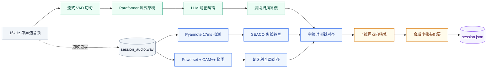

# 会议智能转写与纪要系统 · Meeting ASR & Executive Workspace

[](#快速开始)
[](#它能做什么)
[-2563EB)](#实测数字)
[](#实测数字)
[-7C3AED)](#实测数字)
[](#4-测试)

把一段 **36–40 分钟的多人远场会议录音**（或实时麦克风发言），变成**带说话人、带毫秒时间轴、带标点精修与结构化纪要**的会议工作台。

实时上屏草稿 → 句尾自动定稿 → 会后分清谁说的 → 字级时间戳对齐二遍终稿 → 一键提炼会议纪要。
单声道、纯 CPU、声学与声纹全本地运行。

---

## 它能做什么

```text
00:01:35  张总 (speaker_2)   这个季度的供应链成本我们整体压降了八个百分点。
00:01:41  李经理 (speaker_0) 主要压在哪些环节？
00:01:43  张总 (speaker_2)   核心是华东仓的干线物流和包材集中采购。
```

- **边说边出字（实时流式轨）**：600 ms 增量解码，首字约 **0.92 秒**上屏（灰色斜体草稿 → 句尾静音锁死边界 → 异步 LLM 滑窗纠错转正黑体），边录边写盘，结束后自动扫描补齐流式 VAD 漏掉的弱音段。
- **录音高精直通（文件导入轨）**：导入已有录音时自动跳过流式冗余损耗，由 `pyannote/segmentation-3.0`（17 ms 帧分辨率）提取 **99.88%** 语音区间，交由 SEACO-Paraformer 连续大段解码，39.4 分钟会议仅需 **111.2 秒**（**RTF 0.047**，快 21 倍实时）。
- **分清谁说的（重叠感知声纹分离）**：10s 局部幂集剥离重叠帧 + CAM++ 192 维纯声纹 + 会话均值去偏谱聚类 + 匈牙利 1-to-1 全局帧对齐，句内换人也能按**每个字的毫秒时间戳**精确切开（`sub_turns`）。
- **并发精修与会后小秘书**：4 线程双向语境精修后，一键提炼会议主题、核心决议、责任人待办清单，并在前端支持点击句子跳转播放（HTTP 206）与发言人点击改名。

---

## 架构



- **绿色轨（实时流式）**：负责会议进行时“边说边出字”，结束后自动扫描补齐流式漏检的远场轻声段。
- **蓝色轨（高精离线 & 声纹）**：负责“把谁说的分清、把每个字对准”，录音文件导入（`--direct-offline`）直接走此轨。
- **琥珀轨（大模型智能）**：基于 DeepSeek Prefix Cache 完成跨句双向精修与会后结构化纪要。

---

## 实测数字

### 1. 实时流式延迟账本


### 2. 语音识别（ASR）精度与速度
测试集：**AISHELL-4 `L_R003S01C02`**（39.4 分钟 · 6 人远场 · 重叠率 49.3% · 仅取单声道 `ch0` · 纯 CPU）

| 模式 | CER (字错率) | 替换 / 漏字 / 插入 | 语音覆盖率 | 耗时 (RTF) | 说明 |
|---|---|---|---|---|---|
| **流式 Raw 层** | `36.90%` | 16.25% / 16.58% / 4.07% | 74.15% | 572.5 s (`0.242`) | 实时上屏草稿（`--no-llm --no-final-asr`） |
| **旧版二遍** | `35.87%` | 10.31% / 22.54% / 3.02% | 74.15% | 659.0 s (`0.279`) | 复用流式 VAD 碎片 + 离线 SEACO |
| **新版高精二遍** | **`25.35%`** | **10.12% / 9.94% / 5.29%** | **99.88%** | **111.2 s (`0.047`)** | **Pyannote 全覆盖 + 字级时间戳对齐（快 21 倍实时）** |

### 3. 说话人分离（Diarization）基准
架构：`pyannote/segmentation-3.0`（10s 幂集）+ `CAM++` + 会话均值中心化谱聚类（`KNN_K=12` + 双门限合并）+ 匈牙利 1-to-1 全局帧对齐。

| 评测集 | 规模与场景 | 平均 DER (错误率) | 人数 (K) 盲估命中率 | 句级归属准确率 |
|---|---|---|---|---|
| **AliMeeting Eval** | 8 场远场高重叠多人会议 | **`10.25%`** *(原 35.39%)* | **8 / 8 (100% 精确命中)** | — |
| **AISHELL-4 Eval** | 3 场标准远场会议 | **`4.61%`** | **3 / 3 (100% 精确命中)** | — |
| **AISHELL-4 39.4min** | 6 人连续长会议 | — | **K = 6 精确命中** | **`96.2%`** |

---

## 快速开始

### 1. 环境

```bash
git clone https://github.com/zhangshuai05/my_study_meeting_asr.git
cd my_study_meeting_asr/Meeting_main

conda create -n funasr python=3.12 -y && conda activate funasr
pip install -r ../diarization_cl-main/requirements.txt
```

需要系统已安装 `ffmpeg`（自动将任意格式转为 16 kHz 单声道 `ch0`）。

### 2. 模型

声学与声纹模型来自 ModelScope 与 HuggingFace（`pyannote/segmentation-3.0`），权重不进仓库：

```python
from modelscope import snapshot_download
snapshot_download("iic/speech_fsmn_vad_zh-cn-16k-common-pytorch")                                  # 流式 VAD
snapshot_download("iic/speech_campplus_sv_zh-cn_16k-common")                                       # CAM++ 声纹
snapshot_download("iic/speech_paraformer-large_asr_nat-zh-cn-16k-common-vocab8404-online")         # 流式 ASR
snapshot_download("iic/speech_seaco_paraformer_large_asr_nat-zh-cn-16k-common-vocab8404-pytorch")  # 离线 SEACO
```

> 本地模型路径定义在 [`diarization_cl-main/streaming_asr/web_server.py`](diarization_cl-main/streaming_asr/web_server.py) 顶部常量，换机器时修改对应路径即可。

### 3. 运行

```powershell
$env:PYTHONIOENCODING="utf-8"
$env:DEEPSEEK_API_KEY="sk-..."                     # 可选；不配则自动跳过 LLM 润色

# 启动 Web 工作台（支持实时麦克风录音、导入音频、点击跳播、发言人改名、一键生成纪要）
python stream_service.py                           # http://127.0.0.1:8736

# 命令行高精直通跑单个录音文件（最快、最准）
python run_offline.py --wav meeting.wav --direct-offline

# 命令行流式仿真模式
python run_offline.py --wav meeting.wav --fast
```

### 4. 测试

```bash
python -m pytest -q                                # 223 passed（秒级完成，不加载重型模型）
python -m pytest -m slow -k equivalence -v         # 真实模型事件级等价性夹具（约 30s）
```

---

## 目录与文档

| 路径 | 内容 |
|---|---|
| [`Meeting_main/`](Meeting_main/) | 会议系统主工程：双轨编排、离线字级对齐、并发精修、会后小秘书、极简 Web 工作台 |
| [`Meeting_main/README.md`](Meeting_main/README.md) | **工程手册**：10 文件落盘契约、API 路由表、CLI 参数与排障指南 |
| [`diarization_cl-main/`](diarization_cl-main/) | 说话人分离核心引擎（Powerset 分割 + 均值中心化谱聚类 + 匈牙利全局对齐） |
| [`diarization_cl-main/README.md`](diarization_cl-main/README.md) | **声纹分离引擎文档**：算法链路与 AliMeeting / AISHELL-4 评测明细 |
| [`Meeting_main/reports/`](Meeting_main/reports/) | 延迟对拍、静音阈值扫描与 39.4 分钟长会议实测报告 |

---

## 已知边界

- **单通道物理上限**：多人同时抢话的重叠区间，Powerset 能剥离重叠帧保护声纹聚类不被污染，但单通道 ASR 同一时刻只输出主讲人字词。
- **模型路径未抽离配置文件**：集中在 `diarization_cl-main/streaming_asr/web_server.py` 顶部常量。
- **验证平台**：在 Windows + CPU（Python 3.12）完成全量长跑验证，Linux 未做端到端回归。

---

## 致谢

[FunASR](https://github.com/modelscope/FunASR) · [ModelScope](https://modelscope.cn) · [pyannote.audio](https://github.com/pyannote/pyannote-audio) · [AISHELL-4](https://www.openslr.org/111/) · [AliMeeting](https://www.openslr.org/119/)
