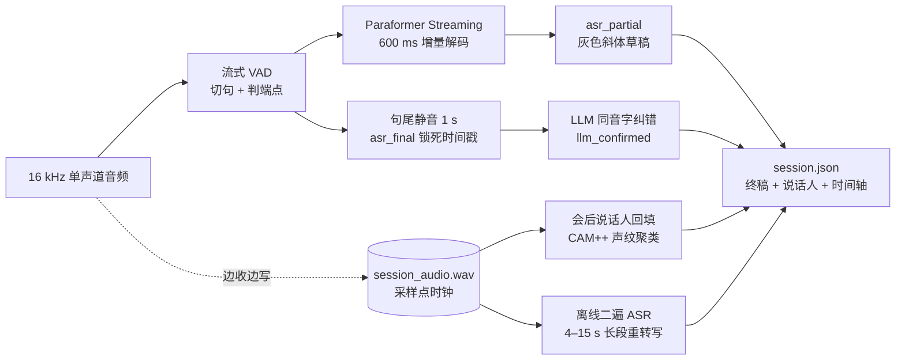

# 会议转写系统 · Meeting ASR

把一段 36–40 分钟的会议录音，变成**带说话人、带时间轴、带标点**的会议纪要。

实时上屏草稿 → 句尾自动定稿 → 会后分清谁说的 → 离线二遍出终稿。
单声道、纯 CPU、全本地运行，音频不出机器。

`Python 3.12` · `CPU only` · `离线` · `Windows / Linux`

---

## 它能做什么

```
00:01:35  speaker_2   这个季度的成本我们压了八个点
00:01:41  speaker_0   压在哪
00:01:43  speaker_2   主要是物流和仓储
```

- **边说边出字**：600ms 一块流式解码，首字约 0.9 秒上屏；草稿是灰色斜体，定稿转正体。
- **自动断句**：VAD 检测句尾静音后锁死 `[start, end]`，时间戳只由累计采样点数算出。
- **句尾纠错**：定稿后异步调 LLM 修同音字与标点，不阻塞上屏。
- **分清谁说的**：会后用 CAM++ 声纹聚类回填说话人，句内换人也能切开。
- **离线二遍**：按说话人把短句拼成 4–15 秒长段，用更强的离线模型重转写，出终稿。

---

## 架构



一条时间轴，两条后处理：左边保证"边说边出字"，右边保证"最后一份是准的"。

---

## 快速开始

### 1. 环境

```bash
git clone https://github.com/zhangshuai05/my_study_meeting_asr.git
cd my_study_meeting_asr/Meeting_main

conda create -n funasr python=3.12 -y && conda activate funasr
pip install -r ../diarization_cl-main/requirements.txt
```

需要系统里有 `ffmpeg`（任意格式转 16 kHz 单声道）。

### 2. 模型

四个模型走 ModelScope，权重不进仓库：

```python
from modelscope import snapshot_download
snapshot_download("iic/speech_fsmn_vad_zh-cn-16k-common-pytorch")                            # VAD
snapshot_download("iic/speech_campplus_sv_zh-cn_16k-common")                                 # 声纹
snapshot_download("iic/speech_paraformer-large_asr_nat-zh-cn-16k-common-vocab8404-online")    # 流式 ASR
snapshot_download("iic/speech_seaco_paraformer_large_asr_nat-zh-cn-16k-common-vocab8404-pytorch")  # 离线二遍
```

> ⚠️ **目前模型路径写死在 `diarization_cl-main/streaming_asr/web_server.py` 顶部**
> （`MODEL_ROOT` / `VAD_LOCAL` / `STREAM_ASR_LOCAL` 等常量）。换机器时改这几行即可，
> 还没做成配置项。

### 3. 跑

```bash
export PYTHONIOENCODING=utf-8      # Windows: $env:PYTHONIOENCODING="utf-8"

# 命令行跑一个文件
python run_offline.py --wav meeting.wav --fast

# 起演示页
python stream_service.py           # http://127.0.0.1:8736
```

演示页上选一个 WAV，点「音频模拟」，就能看到灰色草稿逐句转黑、最后挂上说话人徽章。

### 4. 测试

```bash
python -m pytest -q                              # 200 项左右，不加载模型
python -m pytest -m slow -k equivalence -v       # 事件级等价夹具（会加载模型，约 30s）
```

---

## 实测数字

延迟不是一个数，是四笔账叠出来的。下图是**为什么首字卡在 0.9 秒**：


- **能砍的只有橙色三段**：攒块、前瞻、静音判定。
- 但实测砍 chunk 到 300 ms 后首字仍是 926 ms（600 ms 时 918 ms）——**解码器要攒够上下文才吐第一个 token**，
  这段不在账本里，砍不动。所以最终没改默认值。
- 砍静音到 800 ms 能省 0.34 s 定稿延迟，代价是句数 ×1.5 且开始腰斩，做成开关不设默认。

| 指标 | 数值 | 口径 |
|---|---|---|
| 39.4 分钟长会议 | 572 s 跑完，596 句 | CPU，流式转写，RTF 0.242 |
| 首字上屏 | ≈ 0.9 s | 实时送流模式，600ms 分块 |
| 定稿延迟 | 中位 1.25 s | 含 1.0 s 句尾静音判定 |
| 流式 CER | 38.32% | AISHELL-4 39 分钟，8ch 取 ch0，6 人远场 |

> 数字都有口径，不能混着引用：上表 CER 是**流式 raw 层**（`--no-llm --no-final-asr`），
> 不是产品终稿；终稿走离线二遍，会再降一截。详细对拍见 `reports/`。

---

## 目录

| 路径 | 内容 |
|---|---|
| `Meeting_main/` | 会议系统本体：流式编排、事件契约、Web 服务、评测脚本 |
| `Meeting_main/reports/` | 延迟对拍、静音阈值扫描、39 分钟长跑实测 |
| `diarization_cl-main/` | 说话人分离引擎（VAD / CAM++ / 聚类），会议系统只读依赖 |

---

## 已知边界

- **单通道天花板**：说话人重叠时只能给一个标签，必然错一部分。
- **远场 + 低音量**：VAD 会漏掉弱音段，那部分字后级补不回来。
- **模型路径未配置化**：见上文第 2 步。
- **只在 Windows + CPU 上长期验证过**，Linux 未做端到端回归。

---

## 文档

| 文件 | 内容 |
|---|---|
| `Meeting_main/README.md` | 六文件契约、参数表、实测耗时 |
| `Meeting_main/HANDOFF.md` | 架构总纲与踩过的坑 |
| `Meeting_main/reports/` | 本轮延迟优化实测报告 |
| `diarization_cl-main/README.md` | 说话人分离引擎的产品页 |

---

## 致谢

[FunASR](https://github.com/modelscope/FunASR) · [ModelScope](https://modelscope.cn) ·
[AISHELL-4](https://www.openslr.org/111/) · AliMeeting

## License

尚未确定。补 `LICENSE` 之前默认保留所有权利。
