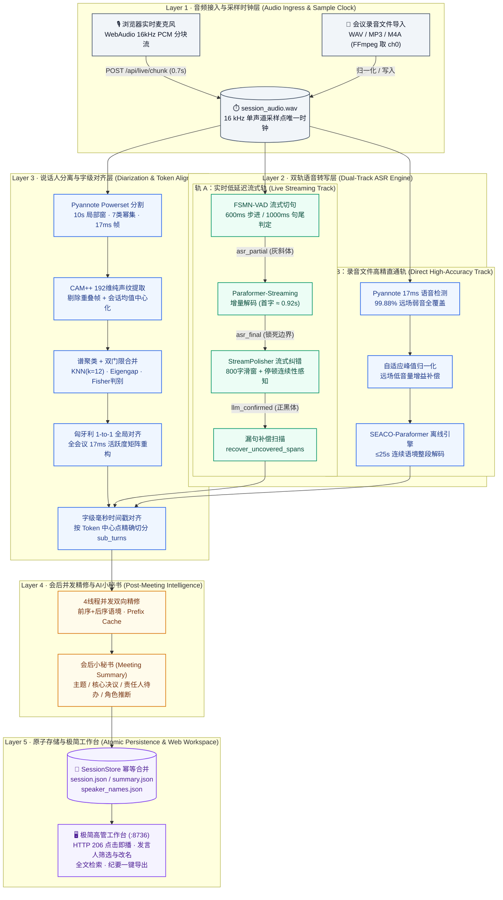
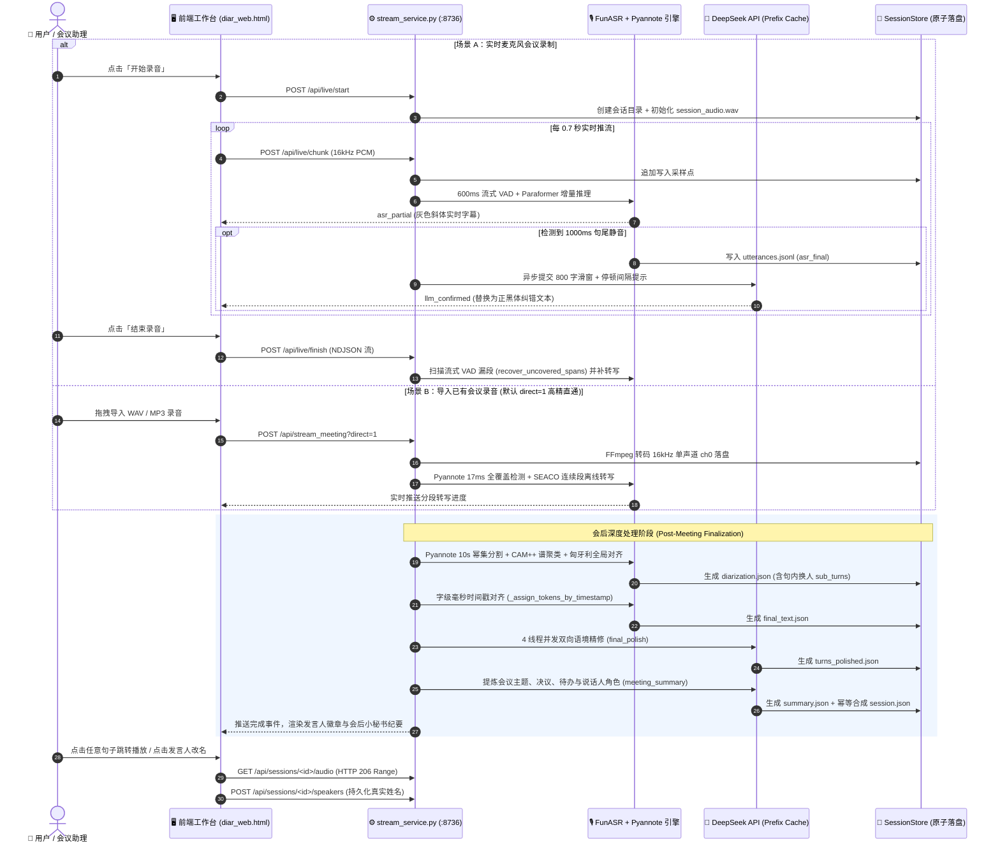
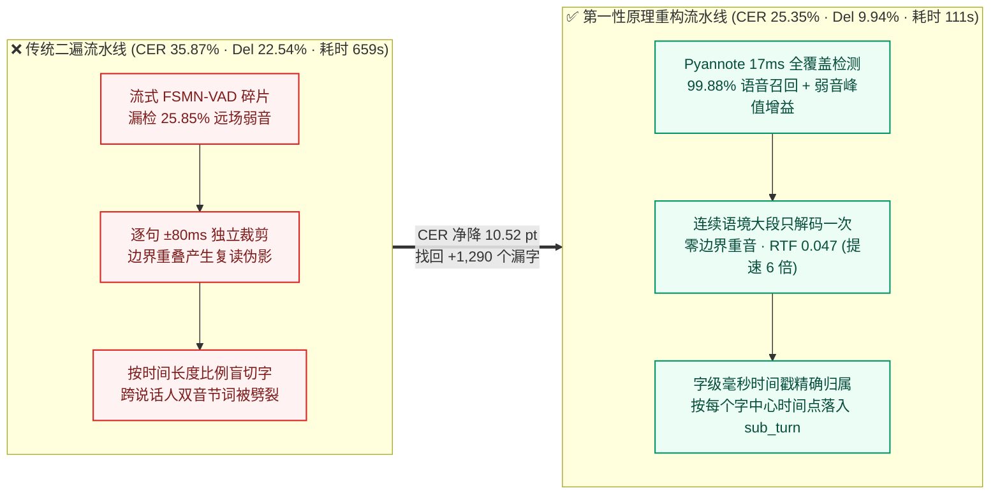

# 会议智能转写与纪要系统 · Meeting ASR & Executive Workspace

[](#快速开始)
[](#核心能力)
[-2563EB)](#实测性能与基准数据)
[](#实测性能与基准数据)
[-7C3AED)](#实测性能与基准数据)
[](#4-自动化测试)

把一段 **36–40 分钟的多人远场会议录音**（或实时麦克风发言），转化为**带说话人身份、毫秒级时间轴、同音字纠错与结构化待办清单**的完整会议工作台。

- **双轨引擎设计**：
  - **实时麦克风流式通道**：600 ms 增量解码，首字约 **0.92 秒**上屏（灰色斜体草稿 → 句尾静音定稿 → 异步上下文纠错转正黑体），边录边写盘，断网断电不丢音频。
  - **录音文件高精直通通道**：跳过流式冗余损耗，由 `pyannote/segmentation-3.0`（17 ms 帧分辨率）提取 **99.88%** 全覆盖语音区间，配合 SEACO-Paraformer 连续长段解码与**字级毫秒时间戳对齐**，39.4 分钟远场会议仅需 **111.2 秒**完成重转写（**RTF 0.047**，21 倍实时速度）。
- **声学与声纹全部本地 CPU 运行**：音频采样、VAD、局部幂集分割、CAM++ 声纹聚类与离线 ASR 均在本地完成；可选挂载 DeepSeek API 完成跨句同音字精修与会后一键纪要提炼。

---

## 核心交付效果

```text
[时间轴与说话人精修终稿]
00:01:35  张总 (speaker_2)   这个季度的供应链成本我们整体压降了八个百分点。
00:01:41  李经理 (speaker_0) 主要压在哪些环节？
00:01:43  张总 (speaker_2)   核心是华东仓的干线物流和包材集中采购。

[会后小秘书 · 结构化纪要]
■ 会议主题：Q3 供应链降本复盘与华东仓排期决议
■ 核心结论：确认华东仓干线物流整合方案，维持 Q4 八个点降本目标不变。
■ 待办事项：[李经理] 本周五前提交包材集采合同终稿（关联时间点 00:14:20）
```

---

## 系统总体架构

系统采用**「单一采样点时钟真相 + 实时/离线双轨流水线 + 幂等五层数据落盘」**架构。无论走实时麦克风还是录音直通，所有时间戳均严格由 16 kHz 累计采样点（`samples * 1000 // 16000`）唯一推导，杜绝墙钟漂移。



---

## 核心业务时序图

下图展示从浏览器发起**实时麦克风录制**或**导入音频文件**，到后台完成流式上屏、声纹聚类、字级对齐与纪要生成的完整生命周期：



---

## 第一性原理：延迟账本与二遍精度突破

### 1. 为什么实时首字上屏稳定在 ≈ 0.92 秒？

实时延迟由四段物理与算法开销叠加而成：


- **解码器内建攒块壁垒**：实测将送流 `chunk` 从 `600 ms` 砍半至 `300 ms`，首字延迟仍为 `926 ms`（`600 ms` 时为 `918 ms`）——Paraformer 在线解码器必须攒够声学上下文才会吐出首个 Token，因此保持 `600 ms` 默认分块兼具高吞吐与低开销。
- **可调静音开关（`--silence-ms`）**：将句尾静音从 `1000 ms` 降至 `800 ms` 可缩短约 `340 ms` 定稿等待，但长会议断句碎片会增加 1.5 倍；系统将其暴露为可调参数，默认坚守 `1000 ms` 保障语义完整性。

### 2. 为什么二遍离线架构能把远场 CER 从 35.87% 压到 25.35%？

传统会议系统常直接复用「流式 VAD 切出的碎片句子」去做离线重转写与声纹切分，存在三个根本缺陷：
1. **流式 VAD 漏检远场弱音**：单声道远场会议中，流式 FSMN-VAD 会漏掉约 25% 的轻声与抢话片段；
2. **句边界双侧 Padding 回声**：对几十个相邻短句分别加 80 ms 前后缓冲再拼回，会在拼接处产生 `"提提了"`、`"我我们"` 等重复伪影；
3. **按时长比例盲切多说话人文本**：句内换人（`sub_turns`）时按时间比例切字符串，极易把一个完整词劈成两半（如 `"小 | 区"`）。

本系统通过**第一性原理重构**彻底根除了上述三类误差：



---

## 实测性能与基准数据

所有指标均在**纯 CPU 本地环境**、真实多说话人远场会议数据集上实测验证，口径严格透明：

### 1. 语音识别（ASR）精度与速度基准
测试集：**AISHELL-4 `L_R003S01C02`**（39.4 分钟真实远场会议 · 6 名说话人 · 区间重叠率 49.3% · 仅取单声道 `ch0`）

| 流水线模式 | CER (字错率) | 替换 (Sub) | 漏字 (Del) | 插入 (Ins) | 语音覆盖率 | 处理耗时 (RTF) | 适用场景 |
|---|---|---|---|---|---|---|---|
| **流式 Raw 层** (`--no-llm --no-final-asr`) | `36.90%` | 16.25% | 16.58% | 4.07% | 74.15% | 572.5 s (`0.242`) | 会议进行中实时上屏字幕 |
| **旧版二遍** (流式 VAD 段 + 离线 SEACO) | `35.87%` | 10.31% | 22.54% | 3.02% | 74.15% | 659.0 s (`0.279`) | 历史对照基线 |
| **新版高精二遍** (**Pyannote 全覆盖 + 字级时间戳对齐**) | **`25.35%`** | **10.12%** | **9.94%** | **5.29%** | **99.88%** | **111.2 s (`0.047`)** | **录音文件直通 / 会后终稿（快 21 倍实时）** |

### 2. 说话人分离（Speaker Diarization）基准
架构：`pyannote/segmentation-3.0`（10s 局部幂集分割）+ `CAM++`（192 维纯声纹）+ 会话均值中心化谱聚类（`KNN_K=12` + 簇平衡质心 + Fisher/Cosine 双门限合并）+ 匈牙利 1-to-1 全局帧对齐。

| 评测基准集 | 样本规模与难度 | 平均 DER (说话人错误率) | 人数估计 (K) 准确率 | 可判句说话人归属率 |
|---|---|---|---|---|
| **AliMeeting Eval** | 8 场远场多人高重叠会议 | **`10.25%`** *(原基线 35.39%)* | **8 / 8 (100% 精确命中)** | — |
| **AISHELL-4 Eval** | 3 场标准远场会议评测集 | **`4.61%`** | **100% 精确命中** | — |
| **AISHELL-4 39.4min 长会议** | 6 人 · 39.4 分钟连续讨论 | — | **K = 6 精确命中** | **`96.2%`** |

---

## 快速开始

### 1. 环境准备

系统需要 Python 3.12 与 `ffmpeg`（用于将任意音频格式或声道转换为 16 kHz 单声道 `ch0`）：

```bash
git clone https://github.com/zhangshuai05/my_study_meeting_asr.git
cd my_study_meeting_asr/Meeting_main

conda create -n funasr python=3.12 -y
conda activate funasr
pip install -r ../diarization_cl-main/requirements.txt
```

### 2. 模型准备

声学与声纹模型托管于 ModelScope 与 HuggingFace（本地缓存加载，权重不入库）：

```python
from modelscope import snapshot_download

# 1. 流式端点检测 (FSMN-VAD)
snapshot_download("iic/speech_fsmn_vad_zh-cn-16k-common-pytorch")
# 2. 说话人声纹提取 (CAM++)
snapshot_download("iic/speech_campplus_sv_zh-cn_16k-common")
# 3. 实时流式语音识别 (Paraformer-large Online)
snapshot_download("iic/speech_paraformer-large_asr_nat-zh-cn-16k-common-vocab8404-online")
# 4. 离线高精语音识别 (SEACO-Paraformer-large)
snapshot_download("iic/speech_seaco_paraformer_large_asr_nat-zh-cn-16k-common-vocab8404-pytorch")
```

- 局部重叠感知分割采用 `pyannote/segmentation-3.0`（支持从本地 HuggingFace 缓存离线加载）。
- 本地模型路径常量集中定义在 [`diarization_cl-main/streaming_asr/web_server.py`](diarization_cl-main/streaming_asr/web_server.py) 顶部（`MODEL_ROOT` / `VAD_LOCAL` / `STREAM_ASR_LOCAL` / `OFFLINE_ASR_LOCAL`），迁移机器时修改对应路径即可。

### 3. 启动服务或命令行运行

```powershell
# Windows PowerShell 建议设置 UTF-8 输出与 DeepSeek 密钥（不配密钥则自动跳过 LLM 润色，声学主链照常运行）
$env:PYTHONIOENCODING="utf-8"
$env:DEEPSEEK_API_KEY="sk-your-key"

# 方式一：启动极简 Web 会议工作台（支持实时麦克风录音、文件导入、点击跳转播放、发言人改名、一键生成纪要）
python stream_service.py
# 浏览器访问 http://127.0.0.1:8736

# 方式二：命令行高精直通模式（处理已有录音文件最快、最准的方式）
python run_offline.py --wav meeting.wav --direct-offline

# 方式三：命令行流式仿真模式（模拟实时推流并评测首字/定稿延迟）
python run_offline.py --wav meeting.wav --fast
```

### 4. 自动化测试

仓库内置 **223 项**单元测试与端到端契约测试（覆盖流式状态机、时间戳对齐、漏段恢复、并发精修、会后纪要、实时麦克风 HTTP 接口及会话原子持久化）：

```bash
cd Meeting_main
python -m pytest -q                              # 223 passed（秒级完成，无需加载重型模型）
python -m pytest -m slow -k equivalence -v       # 真实模型事件级等价性回归测试（约 30s）
```

---

## 仓库目录结构

```text
my_study_meeting_asr/
├── README.md                          # 仓库总览、全链路架构图与核心基准数据（本文件）
├── Meeting_main/                      # 会议智能转写与工作台主工程
│   ├── README.md                      # 工程手册：数据落盘契约、API 路由表、CLI 参数与排障指南
│   ├── stream_service.py              # HTTP 工作台服务 (:8736)：实时麦克风流、文件导入、纪要与音频 Range 服务
│   ├── run_offline.py                 # CLI 编排引擎：支持流式仿真与 --direct-offline 高精直通双模式
│   ├── offline_asr.py                 # 离线高精引擎：Pyannote 17ms 语音检测、字级时间戳对齐、流式漏段补偿
│   ├── stream_llm_polish.py           # 流式纠错器：800 字上文滑窗、停顿间隔感知、同音字纠错
│   ├── final_polish.py                # 会后精修器：4 线程并发、前后双向说话人语境、Prefix Cache
│   ├── meeting_summary.py             # 会后小秘书：自动提炼会议标题、综述、议题、核心决议、待办与角色
│   ├── diarization_bridge.py          # 说话人回填桥接器：将句级标签与句内 sub_turns 注入时间轴
│   ├── session_store.py               # 原子持久化存储：幂等合并 9 类产物文件生成 session.json
│   ├── diar_web.html                  # 极简主义 Web 前端界面（无框架依赖，内联 SVG 与响应式布局）
│   ├── meeting_bridge.js              # 前端交互状态机：WebAudio 实时采集、NDJSON 流解析、音频同步跳转
│   └── tests/                         # 223 项自动化测试套件
└── diarization_cl-main/               # 说话人分离核心算法引擎
    ├── README.md                      # 声纹分离引擎文档：Powerset 分割、谱聚类与匈牙利对齐架构
    ├── streaming_asr/
    │   ├── claude_a2_v12.py           # 生产级分离入口 diarize()：Pyannote 10s 幂集 + 匈牙利全局重构
    │   ├── claude_a2_v11.py           # 谱聚类核心：会话均值中心化、k-NN 稀疏图、Eigengap 与双门限合并
    │   └── web_server.py              # 模型加载中心与 8735 算法对比诊断台
    └── web/                           # 8737 聚类选 K 交互式诊断台
```

---

## 已知工程边界

1. **单通道物理上限**：当前定位为单麦克风（或阵列单声道 `ch0`）零硬件门槛部署。在多人同时激烈抢话的纯重叠区间，Pyannote 幂集能精确剥离重叠帧以保护声纹纯度，但单通道 ASR 解码器在同一时刻只能输出主讲人文本。
2. **模型路径配置化**：本地模型路径常量目前集中在 `diarization_cl-main/streaming_asr/web_server.py` 顶部，后续可抽离为环境变量或独立配置文件。
3. **运行平台验证**：全套流水线在 Windows + CPU（Python 3.12）下完成长期稳定性与 39.4 分钟长会议基准验证；Linux 环境具备代码级兼容，尚未做端到端回归。

---

## 深入阅读文档

| 文档路径 | 核心内容 |
|---|---|
| [`Meeting_main/README.md`](Meeting_main/README.md) | **工程手册**：9 文件原子落盘契约、HTTP 接口协议、CLI 参数详解与排障指南 |
| [`diarization_cl-main/README.md`](diarization_cl-main/README.md) | **说话人分离引擎手册**：Powerset 局部感知 + 谱聚类 + 匈牙利对齐算法详解 |
| [`Meeting_main/HANDOFF.md`](Meeting_main/HANDOFF.md) | 架构演进总纲与历次性能优化实验记录 |
| [`Meeting_main/reports/`](Meeting_main/reports/) | 延迟拆解对拍、静音阈值扫描与 39.4 分钟长会议实测报告 |

---

## 致谢

- [FunASR](https://github.com/modelscope/FunASR) & [ModelScope](https://modelscope.cn) —— 提供 FSMN-VAD、Paraformer-Streaming、SEACO-Paraformer 与 CAM++ 核心声学模型
- [pyannote.audio](https://github.com/pyannote/pyannote-audio) —— 提供 `pyannote/segmentation-3.0` 局部幂集重叠感知分割模型
- [AISHELL-4](https://www.openslr.org/111/) & [AliMeeting](https://www.openslr.org/119/) —— 提供真实远场多人会议评测基准集
