# 长会议说话人分离引擎 · Overlap-Aware Speaker Diarization

[](#快速开始)
[-2563EB)](#实测效果)
[](#实测效果)
[](#核心特性)

把一段 **36–40 分钟的多人远场高重叠会议录音**，精确拆解为「**谁 · 在哪一毫秒 · 说了什么**」的说话人时间轴与句内换人边界（`sub_turns`）。

单声道、纯 CPU、全本地运行，音频不出机器。

> 本目录是**说话人分离算法引擎**（回答"每一帧/每一句是谁说的"）。
> 实时转写、字级时间戳对齐、LLM 精修与极简 Web 工作台的完整链路见 [根目录 README](../README.md) 与 [Meeting_main 工程手册](../Meeting_main/README.md)。

---

## 架构

生产入口为 [`streaming_asr/claude_a2_v12.py`](streaming_asr/claude_a2_v12.py) 的 `diarize()`，底层调用 [`streaming_asr/claude_a2_v11.py`](streaming_asr/claude_a2_v11.py) 的谱聚类组件：

```mermaid
flowchart LR
    A["16kHz 单声道 WAV"] --> B["Pyannote 10s 幂集分割"]
    B --> C["剥离重叠帧<br/>提纯单人掩码"]
    C --> D["CAM++ 192维声纹<br/>+ 会话均值中心化"]
    D --> E["k-NN 谱聚类<br/>+ Eigengap 定 K"]
    E --> F["簇平衡质心<br/>+ 双门限合并"]
    F --> G["匈牙利 1-to-1 指派<br/>17ms 全局矩阵"]
    G --> H["句级归属 + sub_turns"]

    classDef seg fill:#EFF6FF,stroke:#2563EB,color:#1E3A8A
    classDef emb fill:#ECFDF5,stroke:#059669,color:#064E3B
    classDef clu fill:#FFFBEB,stroke:#D97706,color:#78350F
    classDef out fill:#F5F3FF,stroke:#7C3AED,color:#4C1D95
    class A,B,C seg
    class D emb
    class E,F clu
    class G,H out
```



---

## 核心特性

- **10s 局部幂集剥离重叠帧**：用 `pyannote/segmentation-3.0`（7 类幂集、17 ms 帧分辨率）剔除两人同时说话的重叠帧，确保喂给 CAM++ 的每一帧都是 100% 纯净单人语音。
- **会话级均值中心化**：减去当前会议全局均值向量并重新 L2 归一化，消除房间混响与麦克风信道底色。
- **自适应谱聚类 + 双门限合并**：`KNN_K=12` 稀疏图 + Eigengap 自动盲估人数 K + 簇平衡质心（防止话痨吞噬寡言者）+ 无偏 Fisher 判别比与原始余弦双门限合并。
- **匈牙利 1-to-1 全局帧对齐**：通过 `linear_sum_assignment` 约束同窗 3 个局部槽位互斥映射到全局说话人，跨窗口累加构建全会议 17 ms 活跃度矩阵，精准切分句内换人（`sub_turns`）。

---

## 实测效果

所有指标均在**盲估说话人数 K**、**单声道（取 `ch0`）**、**纯 CPU** 条件下实测（`md-eval` 全区间口径）：

| 评测基准集 | 场景规模 | 旧版基线 DER | **当前引擎 DER** | **人数 (K) 盲估命中率** | 句级归属准确率 |
|---|---|---|---|---|---|
| **AliMeeting Eval** | 8 场远场高重叠多人会议 | `35.39%` | **`10.25%`** *(净降 25.14 pt)* | **8 / 8 (100% 精确命中)** | — |
| **AISHELL-4 Eval** | 3 场标准远场会议 | `14.80%` | **`4.61%`** | **3 / 3 (100% 精确命中)** | — |
| **AISHELL-4 39.4min** | 6 人 · 39.4 分钟长会议 | — | — | **K = 6 精确命中** | **`96.2%`** |

### AliMeeting Eval 8 场明细

| 会议 ID | 真实 $K$ | 预测 $K$ | 旧版 DER | **当前 DER** |
|---|---|---|---|---|
| `R8001_M8004` | 4 | **4** | 30.89% | **`10.22%`** |
| `R8003_M8001` | 4 | **4** | 31.12% | **`11.57%`** |
| `R8007_M8010` | 3 | **3** | 28.45% | **`3.29%`** |
| `R8007_M8011` | 3 | **3** | 33.10% | **`7.64%`** |
| `R8008_M8013` | 4 | **4** | 41.20% | **`11.49%`** |
| `R8009_M8018` | 4 | **4** | 38.75% | **`10.89%`** |
| `R8009_M8019` | 4 | **4** | 42.18% | **`14.12%`** |
| `R8009_M8020` | 4 | **4** | 37.43% | **`12.78%`** |
| **8 场平均** | — | **8 / 8 全中** | `35.39%` | **`10.25%`** |

---

## 快速开始

### 1. 环境与模型

```bash
pip install -r requirements.txt
```

需要系统里有 `ffmpeg`，并下载 ModelScope 声纹/VAD 模型与 HuggingFace `pyannote/segmentation-3.0`。

### 2. Python 调用生产入口

```python
import sys
sys.path.insert(0, "streaming_asr")
from web_server import get_models
from claude_a2_v12 import diarize

models = get_models(need_stream=False, need_offline=False)
result = diarize("meeting.wav", models)
```

### 3. 诊断台与测试

```bash
python streaming_asr/web_server.py             # http://127.0.0.1:8735 (多配置对比台)
python web/server.py                           # http://127.0.0.1:8737 (选 K 调参诊断台)
cd streaming_asr && python -B -m pytest -q     # 运行回归测试
```

---

## 项目结构

| 目录 / 文件 | 内容 |
|---|---|
| [`streaming_asr/claude_a2_v12.py`](streaming_asr/claude_a2_v12.py) | **生产入口 `diarize()`**：Pyannote 10s 幂集提取 + 匈牙利 1-to-1 全局帧重构 |
| [`streaming_asr/claude_a2_v11.py`](streaming_asr/claude_a2_v11.py) | **谱聚类核心**：会话均值中心化、`KNN_K=12`、Eigengap、簇平衡质心、双门限合并 |
| [`streaming_asr/web_server.py`](streaming_asr/web_server.py) | 模型加载中心与 8735 对比台 |
| [`web/`](web/) | 8737 聚类选 K 诊断台 |
| [`scripts/evaluation/`](scripts/evaluation/) | AliMeeting / AISHELL-4 评测脚本 |

---

## 致谢

[pyannote.audio](https://github.com/pyannote/pyannote-audio) · [FunASR](https://github.com/modelscope/FunASR) · [ModelScope](https://modelscope.cn) · [AliMeeting](https://www.openslr.org/119/) · [AISHELL-4](https://www.openslr.org/111/)
