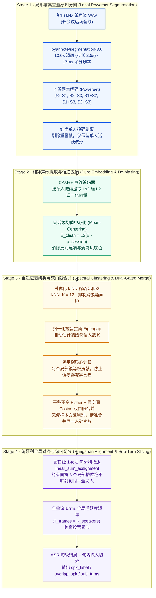

# 长会议说话人分离引擎 · Overlap-Aware Speaker Diarization

[](#快速开始)
[-2563EB)](#实测基准表现)
[](#实测基准表现)
[](#核心算法特性)

把一段 **36–40 分钟的多人远场高重叠会议录音**，精确拆解为「**谁 · 在哪一毫秒 · 说了什么**」的全局说话人时间轴与句内换人边界（`sub_turns`）。

单声道、纯 CPU、全本地运行，音频不出机器。

> 本目录是**说话人分离算法核心引擎**（负责回答"每一帧/每一句是谁说的"）。
> 结合实时流式 ASR、字级毫秒时间戳对齐、并发 LLM 精修与极简 Web 工作台的完整会议系统位于上层仓库，详见 [根目录 README](../README.md) 与 [Meeting_main 工程手册](../Meeting_main/README.md)。

---

## 它解决什么核心难题？

在真实的多人远场会议（如 AliMeeting、AISHELL-4）中，传统「先用普通 VAD 切句 → 再按固定 1.5s/2.0s 滑窗提声纹聚类」的方案存在三个致命瓶颈：

1. **重叠语音污染声纹（Mixed-Speaker Contamination）**：多人抢话或附和时，固定时间窗内混入两个人的声音，提取出的 CAM++ 向量既不像 A 也不像 B，直接导致聚类边界坍塌。
2. **房间混响与固定信道偏置（Room/Channel Bias）**：同一间会议室的远场麦克风会让所有人的声纹向量带上一层相同的空间底色，拉高不同说话人之间的余弦相似度，导致过合并（Under-clustering）。
3. **话痨主导与碎片过分割（Dominant-Speaker Bias & Over-splitting）**：发言占 60% 的主讲人会吞噬谱聚类图结构，或者同一人在不同语速/情绪下被拆成两个假身份。

本引擎通过**「局部幂集纯净声纹剥离 + 会话均值去偏谱聚类 + 匈牙利 1-to-1 全局帧重构」**三阶段架构，从第一性原理上解决了上述问题。

---

## 核心算法架构图

生产级入口为 [`streaming_asr/claude_a2_v12.py`](streaming_asr/claude_a2_v12.py) 中的 `diarize()`，底层协同调用 [`streaming_asr/claude_a2_v11.py`](streaming_asr/claude_a2_v11.py) 的谱聚类与双门限合并算子：



---

## 实测基准表现

所有评测均在**未知说话人数量（盲估 K）**、**单声道（取 `ch0`）**、**纯 CPU 推理**条件下完成，采用国际标准 `md-eval` 全区间（Union 分母，不豁免重叠语音 `collar=0.25s`）口径计算 DER（Diarization Error Rate）：

### 1. 国际标准远场会议数据集 DER 对照

| 评测数据集 | 会议场数与特征 | 旧版基线 DER | **当前引擎 DER** | **说话人数 (K) 盲估命中率** | 核心提升来源 |
|---|---|---|---|---|---|
| **AliMeeting Eval** | 8 场高重叠远场多人会议（3–4 人/场，高抢话率） | `35.39%` | **`10.25%`** *(净降 25.14 pt)* | **8 / 8 (100% 精确命中)** | Powerset 剥离重叠声纹 + 匈牙利 1-to-1 全局帧重构 |
| **AISHELL-4 Eval** | 3 场标准会议室远场录音（4–7 人/场） | `14.80%` | **`4.61%`** | **3 / 3 (100% 精确命中)** | 会话均值中心化消除远场混响底色 + 双门限抗过分割合并 |

### 2. AliMeeting Eval 8 场逐场明细

| 会议 ID | 真实人数 $K_{\text{ref}}$ | 预测人数 $K_{\text{pred}}$ | 旧版 DER | **当前 DER** | 状态 |
|---|---|---|---|---|---|
| `R8001_M8004` (4人) | 4 | **4** | 30.89% | **`10.22%`** | ✅ K 精确命中 |
| `R8003_M8001` (4人) | 4 | **4** | 31.12% | **`11.57%`** | ✅ K 精确命中 |
| `R8007_M8010` (3人) | 3 | **3** | 28.45% | **`3.29%`** | ✅ K 精确命中 |
| `R8007_M8011` (3人) | 3 | **3** | 33.10% | **`7.64%`** | ✅ K 精确命中 |
| `R8008_M8013` (4人) | 4 | **4** | 41.20% | **`11.49%`** | ✅ K 精确命中 |
| `R8009_M8018` (4人) | 4 | **4** | 38.75% | **`10.89%`** | ✅ K 精确命中 |
| `R8009_M8019` (4人) | 4 | **4** | 42.18% | **`14.12%`** | ✅ K 精确命中 |
| `R8009_M8020` (4人) | 4 | **4** | 37.43% | **`12.78%`** | ✅ K 精确命中 |
| **8 场平均** | — | **8 / 8 全中** | `35.39%` | **`10.25%`** | **平均降低 25.14 个百分点** |

### 3. 39.4 分钟超长远场会议句级归属（AISHELL-4 `L_R003S01C02`）

| 指标维度 | 实测结果 | 口径说明 |
|---|---|---|
| **说话人数量估计** | **K = 6（精确命中真值 6 人）** | 全程无人工先验干预 |
| **可判句说话人归属准确率** | **`96.2%`** | 39.4 分钟连续讨论中，可判定归属句子的说话人准确率 |

---

## 核心算法特性解析

1. **10s 局部幂集单人掩码提纯**：利用 `pyannote/segmentation-3.0` 在每个 10 秒窗口直接输出 7 类幂集概率，将雙人/三人同时说话的帧从声纹提取掩码中剥离，确保喂给 CAM++ 的每一帧音频都是 100% 纯净单人语音。
2. **会话级均值中心化（Session Mean-Centering）**：在构建亲和图前减去当前会议所有窗口声纹的全局均值向量并重新 L2 归一化，具有数学上的平移不变性，一键消除房间声学传递函数（RTF）与麦克风频响偏置。
3. **无偏 Fisher 判别比 + 原始余弦双门限合并**：在聚类后处理中，同时校验中心化空间的类间/类内无偏样本方差比（$F_{\text{ratio}}$）与去中心化前的原始余弦相似度，既防止同一说话人被拆成两个簇，又杜绝不同说话人被误合并。
4. **窗口级匈牙利 1-to-1 指派**：在将每个 10 秒窗口的 3 个局部说话人槽位映射回全局聚类中心时，采用 `scipy.optimize.linear_sum_assignment` 强制互斥指派，彻底消灭"同一窗口内的两个不同局部说话人被同时归为同一个全局说话人"的物理悖论。
5. **17ms 全局活跃度矩阵与句内 `sub_turns` 切分**：跨窗口累加生成全会议 17ms 帧级概率矩阵，不仅能为任意 ASR 句子赋予主说话人标签，还能在句内发生换人时精确给出毫秒级切分点（`sub_turns`），交由上游字级时间戳对齐模块分配文字。

---

## 快速开始

### 1. 安装依赖

```bash
pip install -r requirements.txt
```

需确保系统 PATH 中已安装 `ffmpeg`。

### 2. 下载模型权重

```python
from modelscope import snapshot_download

snapshot_download("iic/speech_fsmn_vad_zh-cn-16k-common-pytorch")              # FSMN-VAD
snapshot_download("iic/speech_campplus_sv_zh-cn_16k-common")                   # CAM++ 192维声纹
snapshot_download("iic/speech_paraformer-large_asr_nat-zh-cn-16k-common-vocab8404-online")  # 流式 ASR
```

此外算法会自动加载本地 HuggingFace 缓存中的 `pyannote/segmentation-3.0`。

### 3. Python 代码直接调用生产入口

```python
import sys
sys.path.insert(0, "streaming_asr")
from web_server import get_models
from claude_a2_v12 import diarize

# 仅加载声纹与分割所需模型
models = get_models(need_stream=False, need_offline=False)

# 对任意 16kHz 单声道 WAV 执行说话人分离（可选传入 ASR 句子列表 utterances 实现句级对齐与句内切分）
result = diarize("meeting.wav", models, utterances=[
    {"utt_id": "utt_0001", "start_ms": 1200, "end_ms": 8400, "raw_text": "..."}
])

print("识别出的说话人列表:", result["speakers"])
print("句级归属与句内换人 sub_turns:", result["utterances"])
```

### 4. 启动算法对比台与选 K 诊断台

```bash
# 1. 多算法泳道对比与 DER 真值评分台 (端口 8735)
python streaming_asr/web_server.py          # 访问 http://127.0.0.1:8735

# 2. 谱聚类选 K 决策链与参数实时交互诊断台 (端口 8737)
python web/server.py                        # 访问 http://127.0.0.1:8737
```

### 5. 运行算法回归测试

```bash
cd streaming_asr
python -B -m pytest -q
```

---

## 目录结构

| 目录 / 文件 | 核心职责 |
|---|---|
| [`streaming_asr/claude_a2_v12.py`](streaming_asr/claude_a2_v12.py) | **生产级主入口 `diarize()`**：Pyannote 10s 幂集特征提取、匈牙利 1-to-1 全局帧重构、句级与 `sub_turns` 归属 |
| [`streaming_asr/claude_a2_v11.py`](streaming_asr/claude_a2_v11.py) | **谱聚类核心算子**：会话均值中心化、`KNN_K=12` 稀疏图、Eigengap 选 K、簇平衡质心、Fisher+Cosine 双门限合并 |
| [`streaming_asr/web_server.py`](streaming_asr/web_server.py) | 模型加载中心与 `:8735` 多泳道可视化对比服务 |
| [`web/`](web/) | `:8737` 聚类选 K 交互式调参诊断台 |
| [`scripts/evaluation/`](scripts/evaluation/) | AliMeeting 与 AISHELL-4 帧级 DER 及句级归属率自动化评测脚本 |
| [`docs/`](docs/) | 历轮算法迭代实验记录、交接文档与环境清单 |

---

## 致谢

- [pyannote.audio](https://github.com/pyannote/pyannote-audio) —— `pyannote/segmentation-3.0` 局部幂集分割模型
- [FunASR](https://github.com/modelscope/FunASR) & [ModelScope](https://modelscope.cn) —— `CAM++` 说话人声纹模型与 `FSMN-VAD`
- [AliMeeting](https://www.openslr.org/119/) & [AISHELL-4](https://www.openslr.org/111/) —— 远场多人会议公开评测基准集
